# WebRAG: Web Ingestion & Multi-Domain RAG Pipeline

A lightweight, modular pipeline and single-page research web app to ingest web content into clean, structured datasets and serve multi-domain RAG queries powered by Google's **Gemini API** by default, with local **Ollama** (`bge-m3` + **Qwen**) models available as alternatives.

---

## Full Pipeline Architecture

WebRAG keeps each subject's content in its own ChromaDB collection while sharing
the ingestion, retrieval, and generation pipeline. GitHub renders the Mermaid
diagram below directly in this README.

```mermaid
flowchart LR
  subgraph Ingestion["Web ingestion pipeline"]
    URL["Page URL or crawl request"] --> FETCH["Safe fetch and crawl"]
    FETCH --> EXTRACT["Extract and clean content"]
    EXTRACT --> CHUNK["Heading-aware, section-context chunks"]
    CHUNK --> STORE["Catalog and chunk storage"]
    CHUNK --> EMBED["BGE-M3 embeddings"]
    EMBED --> INDEX["ChromaDB vector index"]
    STORE --> COLLECTIONS["Named collections<br/>research · immigration · ai_tech"]
    INDEX --> COLLECTIONS
  end

  subgraph Query["Question answering pipeline"]
    QUESTION["Question in Reading Room"] --> ROUTE{"Small talk or page question?"}
    ROUTE -->|"Greeting / identity / acknowledgement"| CHAT["Chat response"]
    ROUTE -->|"Question about saved pages"| SCOPE["Select collection and optional page scope"]
    SCOPE --> RETRIEVE["Hybrid retrieval<br/>dense vectors + BM25"]
    RETRIEVE --> CANDIDATES["Retrieved candidate passages"]
    CANDIDATES --> HAS_SOURCES{"Any passages found?"}
    HAS_SOURCES -->|"No"| NOT_FOUND["Emit not-found response"]
    HAS_SOURCES -->|"Yes"| RERANK{"Gemini and CUDA reranker available?"}
    RERANK -->|"Yes"| CROSS["BGE reranker orders candidates"]
    RERANK -->|"No"| ORDERED["Keep retrieval order"]
    CROSS --> CONTEXT["Fit selected passages into model context"]
    ORDERED --> CONTEXT
    CONTEXT --> MODEL{"Selected generation model"}
    MODEL -->|"Gemini"| GEMINI["Gemini strict JSON response<br/>answerable + cited answer"]
    MODEL -->|"Ollama"| OLLAMA["Local Qwen response"]
    GEMINI --> VALIDATE["Check refusal and citation validity"]
    OLLAMA --> VALIDATE
    VALIDATE --> RESULT["Stream answer, not-found, or excerpt fallback"]
    NOT_FOUND --> RESULT
    CHAT --> RESULT
    RESULT --> UI["Answer with citation chips and evidence panel"]
  end

  COLLECTIONS --> SCOPE
  INDEX --> RETRIEVE
```



---

## The Reading Room (Web Application)

A desktop-first web application designed for focused research with strict evidence citations:
- **Warm Paper Aesthetics**: OKLCH color system with paper backgrounds, ink typography, and rust accents.
- **Three-Column Layout**: Collapsible Library rail (left), Conversation thread with auto-growing composer (center), and contextual Source passage panel (right).
- **Inline Citations & Evidence Linking**: Hover any `[n]` citation chip in an answer for a quick preview, or click to inspect the passage highlighted within its original document context.
- **Bilingual**: Designed and styled for mixed **English and Vietnamese** reading without clipping diacritics.
- **Standalone Mock Mode & Live Backend**: Works out-of-the-box in Mock Mode or connected directly to your local FastAPI server.

---

## Running the Web App

### Quick Launch (Backend + Web App in One Command)

```bash
# 1. Activate Python virtual environment
.\.venv\Scripts\activate

# 2. (Optional) Configure Gemini with a rotated API key in PowerShell
$env:GEMINI_API_KEY = "YOUR_ROTATED_GEMINI_API_KEY"

# 3. Start the unified server
python serve.py
```

Open your browser to:
* **Web App:** [http://localhost:8000](http://localhost:8000)
* **Interactive API Docs:** [http://localhost:8000/docs](http://localhost:8000/docs)

The default generation model is **Gemini 3.5 Flash**. Choose another generation
model in **Settings → Generation model** to use an available local Ollama model.
Gemini uses the backend-only `GEMINI_API_KEY` environment variable; without a
configured key, the UI selects an available local model instead. Set
`WEBRAG_GEN_MODEL` to override the backend's default.
Never put an API key in frontend code or commit it to the repository. The key
previously shared in chat should be revoked and replaced before use.
Gemini uses section-aware passage context, retrieves at least eight passages per
question, and has a separate 30,000-character reference-context budget with a
1,500-token output limit by default. Override the Gemini context and output limits with
`WEBRAG_MAX_CONTEXT_CHARS_GEMINI` and `WEBRAG_GEMINI_MAX_OUTPUT_TOKENS`.
For broad overview or key-points questions, Gemini is prompted to produce a
complete, cited 5-7 point synthesis (aiming for 250-400 words when supported by
the retrieved evidence); focused questions retain concise answers.
Gemini strict responses use JSON output with an explicit `answerable` flag so a
model refusal is not inferred from answer wording. Partial answers should cite
the supported details and state what the passages do not establish. Invalid
structured output or citations fall back to a clearly labeled source excerpt.
The reranker orders passages; its score is not used to decide whether a question
is answerable. Greetings, model-identity questions, and short acknowledgements
are routed to normal chat; procedure questions such as “Are you able to tell me
the passport fee?” still use saved-page retrieval.

To pull the 4B Qwen3 model manually, run `ollama pull qwen3:4b`. Qwen3 generation
uses `think: false` and a 4096-token context profile.

### Benchmarking embedding models

The bilingual retrieval benchmark compares `nomic-embed-text`, `bge-m3`, and
`qwen3-embedding:0.6b` against 10 English and 10 Vietnamese questions grounded
in the current `data/chunks.jsonl` corpus. It reports dense and hybrid Hit@k/MRR;
it re-embeds the corpus in memory and does not change the app's active index or
default embedding model.

```powershell
ollama pull qwen3-embedding:0.6b
.\.venv\Scripts\python.exe scripts\benchmark_embeddings.py --details
```

Omit `bge-m3:latest` or provide `--models` to compare a different set of local
Ollama models. Add `--output path\to\results.json` to save a JSON report. Review
and expand `benchmarks/embedding_queries.json` with representative queries before
using the results to make a production model decision.

`benchmarks/ood_threshold_candidates.verified.json` contains reviewed
out-of-scope cases with dev/test assignments and retrieval-risk annotations.
Use only clear low/medium-risk cases when fitting a dense-score threshold; keep
high-risk cases as challenge examples because they can be semantically close to
saved content while still asking for unsupported details. The current set has
only two fit-eligible dev negatives and three test negatives, so it is not yet
large enough to justify changing the production thresholds. The runtime
relevance check also accepts BM25 scores of 6 or higher, which a dense cutoff
cannot override.

### Active embedding model

The default embedding model is `bge-m3:latest` for both English and Vietnamese.
The existing Nomic index is preserved at `data/chroma`; the application now uses
the rebuilt BGE-M3 index at `data/chroma_bge_m3`. To rebuild after changing
chunks, run `python cli.py index --force`. Set `WEBRAG_EMBED_MODEL` or
`WEBRAG_CHROMA_DIR` on the backend to explicitly override these defaults.

*(Optional) For frontend hot-reloading during development:*
```bash
cd frontend
npm run dev
# Accessible at http://localhost:5173
```

---

## CLI Usage

You can also operate everything directly from your terminal:

```bash
# Ingest into specific collections
python cli.py ingest https://fastapi.tiangolo.com/tutorial/first-steps/ --collection ai_tech
python cli.py ingest https://en.wikipedia.org/wiki/Retrieval-augmented_generation --collection default

# List all ingested pages and status
python cli.py list

# Index chunks into ChromaDB vector store
python cli.py index

# Ask questions with citations
python cli.py query "How do I create a basic path operation in FastAPI?" --collection ai_tech
```

The web composer supports two retrieval modes:

- **Dense (Vector only):** semantic similarity using `bge-m3`.
- **Hybrid (Vector + BM25):** combines semantic similarity with exact-term BM25
  matching, which is useful for procedure names, codes, acronyms, and names.
Hybrid mode is the default for API requests and does not require an additional
re-index of existing chunks. Gemini requests rerank hybrid candidates with
`BAAI/bge-reranker-v2-m3` on CUDA by default. Local Ollama requests skip the
reranker: CPU inference was too slow on this machine. Reranking does not require
re-embedding or rebuilding the vector index. CUDA-enabled PyTorch is needed for
GPU acceleration; without CUDA, Gemini falls back to the original retrieval
order. On the tested Windows/Python 3.14 setup, install the CUDA 12.8 wheel
with:

```powershell
.\.venv\Scripts\python.exe -m pip install --force-reinstall torch==2.11.0+cu128 --index-url https://download.pytorch.org/whl/cu128
```

Disable reranking for a backend session with:

```powershell
$env:WEBRAG_ENABLE_RERANKER="false"
python serve.py
```

The current configuration reranks at most 12 candidates, uses batches of 8,
and truncates each question/passage pair at 256 tokens. Adjust these benchmark
parameters with `--candidate-k`, `--batch-size`, and `--max-length`.

Compare hybrid retrieval with and without reranking on the labeled bilingual
query set:

```powershell
.\.venv\Scripts\python.exe scripts\benchmark_reranker.py
```

The script reports candidate recall, Hit@1/3/5, MRR@5, and warm per-query
retrieval/reranking latency by language and overall. On the 20-query development
set, the tuned 12-candidate, 256-token configuration improved overall Hit@1
from 0.50 to 0.75, Hit@5 from 0.95 to 1.00, and MRR@5 from 0.677 to 0.875.
English Hit@1/MRR@5 changed from 0.60/0.767 to 0.80/0.900; Vietnamese changed
from 0.40/0.587 to 0.70/0.850. The correct passage was present in the candidate
pool for all 20 queries. Warm reranking averaged 4.49 seconds per query
(p50 4.59s) on the GTX 1650 Ti, with a one-time model load of 10.89s. The
reranker improved reciprocal rank on 10 queries and regressed on 2; both
regressions moved the labeled passage from rank 1 to rank 2. Inspection found
both were real misranks rather than incomplete labels: a lost-passport notice
was ranked above the provincial passport-issuance duration, and the YOLO
overview abstract was ranked above the specific YOLO27 training passage.

These 20 labeled cases are a small development set, not enough to establish a
broad performance claim. Add representative answerable and unanswerable cases
before treating these gains as generalizable.

An untouched, separate 40-question holdout (15 answerable, 25 unanswerable) is
stored in `benchmarks/reranker_holdout.json`. The 12-candidate, 256-token
configuration was kept fixed for this run. To reduce the chance of a long Chroma
run failing, execute the two halves separately:

```powershell
.\.venv\Scripts\python.exe scripts\benchmark_reranker.py `
  --cases benchmarks\reranker_holdout.json `
  --start-index 0 --end-index 20 `
  --candidate-k 12 --batch-size 8 --max-length 256

.\.venv\Scripts\python.exe scripts\benchmark_reranker.py `
  --cases benchmarks\reranker_holdout.json `
  --start-index 20 --end-index 40 `
  --candidate-k 12 --batch-size 8 --max-length 256
```

All 15 answerable targets appeared in the initial 12 results. For those
answerable cases (the first 20 holdout entries), hybrid vs. reranked metrics
were: overall Hit@1 0.400 vs. 0.400, Hit@5 0.800 vs. 0.933, MRR@5 0.550 vs.
0.628; English MRR@5 0.635 vs. 0.760; Vietnamese MRR@5 0.452 vs. 0.476. One
target was removed by the relevance gate before reranking despite appearing at
raw retrieval rank 3. The gate accepted all 5 unanswerable questions in that
first half and all 20 in the second half (25/25 total).

Do not use the top reranker score as a refusal threshold based on this
experiment. The 15 answerable scores ranged from 0.5266 to 0.9994, while the
20 added unanswerable cases ranged from 0.0060 to 0.9754 (median 0.3137).
These distributions overlap: a threshold high enough to reject every labeled
unanswerable case would also reject at least one labeled answerable case. The
reranker is retained for ordering candidates, not deciding whether the corpus
can answer a question. The relevance gate also fails to reject these negatives.

In the second half, warm retrieval averaged 2.617s and reranking 4.486s per
query (p50 reranking 4.589s), after a 9.19s model load. The holdout is small,
and its added negative examples are not a substitute for end-to-end response
evaluation. No Gemini end-to-end refusal rate was measured because
`GEMINI_API_KEY` was not configured for the benchmark run. Keep these
answerable-only ranking results separate from the development-set results.

The reranker already scores passages with their title and section prepended
before the chunk text; these fields are placed first so they survive truncation.
For the two earlier rank regressions, the answer-bearing text ended at pair
token 26 (provincial passport duration) and token 179 (YOLO27 foreground
alignment), both within 256 tokens. Testing 384 tokens on those two queries
moved both targets from rank 2 to rank 1, but warm latency rose from about 5.0s
to 6.9s per query. Since neither target answer was truncated and the test only
covers two tuning-set queries, keep the production setting at 256 pending a
larger independent evaluation.

The `nomic-embed-text` integration prefixes stored passages with
`search_document:` and questions with `search_query:`. After changing embedding
prefixes or the embedding model, rebuild vectors with `python cli.py index
--force`. The BGE-M3 migration uses a separate Chroma directory so the previous
index remains available as a backup. If chunking or extraction behavior has
changed as well, force-ingest each saved URL first (for example,
`python cli.py ingest <url> --collection <collection> --force`) so the updated
chunks are saved before re-indexing.

### Bounded site crawling

The backend exposes a background crawl job API:

```http
POST /api/crawl
Content-Type: application/json

{
  "start_url": "https://example.org",
  "collection": "default",
  "max_pages": 25,
  "max_depth": 2
}
```

The response contains a `job_id`. Poll `GET /api/crawl/{job_id}` for status or
send `DELETE /api/crawl/{job_id}` to request cancellation. Progress is also
published as `crawl_progress` on the existing `GET /api/pages/events` stream.
The crawler stays on the exact starting host, observes `robots.txt`, optionally
seeds URLs from a sitemap, limits crawl depth and page count, skips non-HTML or
oversized responses, and refuses non-public DNS addresses and cross-host
redirects. Child-page query strings are restricted to the `query_allowlist`
(default: `id`); `allow_paths` and `deny_paths` can further limit paths.

---

## Project Structure

```
webIngestionRagModel/
├── data/
│   ├── raw/                 # <doc_id>.html snapshots
│   ├── chroma_bge_m3/        # Active BGE-M3 ChromaDB vector collections
│   ├── chroma/              # Preserved previous vector index
│   ├── catalog.db           # SQLite crawl state & collection tracking
│   ├── documents.jsonl      # Clean Markdown documents
│   └── chunks.jsonl         # Extracted chunks with metadata
├── frontend/                # Single-page React + TypeScript + Vite app
│   ├── src/
│   │   ├── api/             # types.ts, client.ts (live SSE + mock mode)
│   │   ├── features/
│   │   │   ├── library/     # AddLinkInput, LibraryPanel, LibraryPageRow
│   │   │   ├── ask/         # Composer, AnswerMessage, CitationChip
│   │   │   └── source/      # SourcePanel (passage context + highlighted excerpt)
│   │   └── components/      # SettingsDrawer (theme, top-k, API config, export)
│   └── dist/                # Production build served by FastAPI
├── src/webrag/
│   ├── models.py            # Dataclasses (RawPage, Document, Chunk)
│   ├── fetch/               # http.py (single-page fetcher), crawler.py (safe bounded site crawl)
│   ├── extract/             # cleaner.py (Trafilatura markdown extraction & canonicalization)
│   ├── chunk/               # markdown.py (Heading-aware chunker with context prefixes)
│   ├── store/               # catalog.py (SQLite & JSONL file storage manager)
│   ├── index/               # embed.py, vectordb.py, rerank.py (embeddings, retrieval, cross-encoder)
│   ├── rag/                 # generate.py (Qwen prompt assembly & cited generation)
│   └── api/                 # server.py (FastAPI backend with SSE streaming)
├── serve.py                 # Unified backend & frontend server
├── cli.py                   # Unified CLI tool
└── requirements.txt
```
